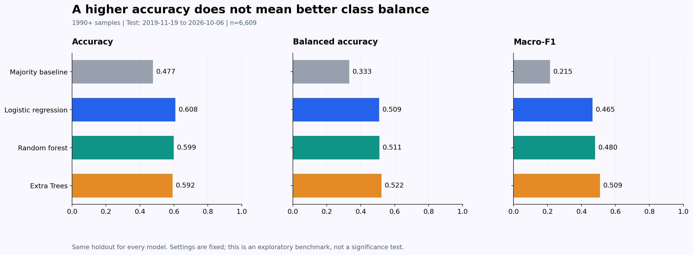
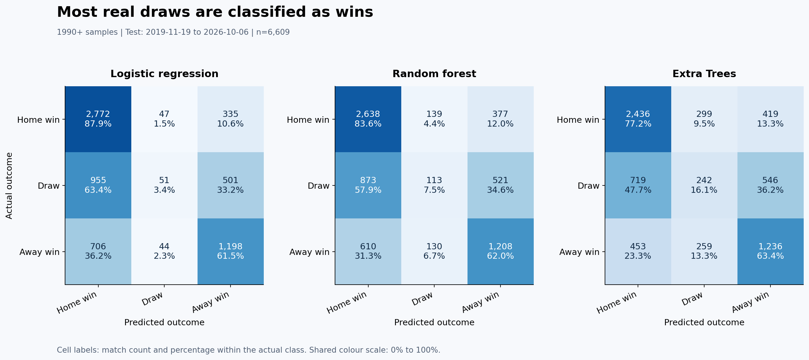
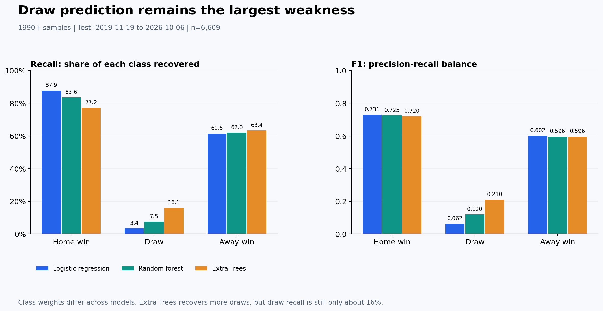
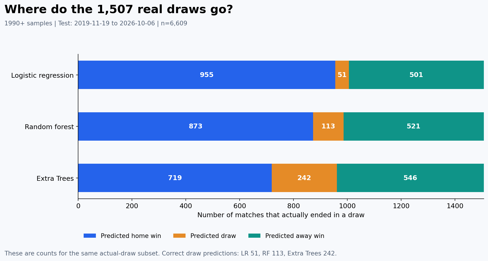
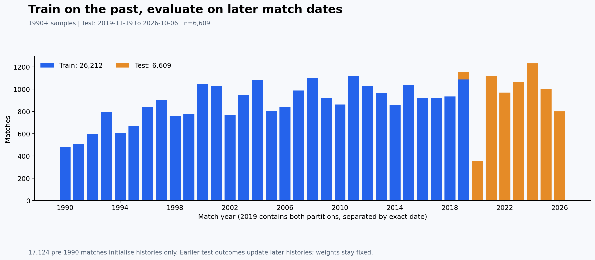

# Model results: visual analysis

Companion to `notebooks/02_feature_engineering_and_models.ipynb`. These figures use the saved measured run, not new forecasts or simulated results. Prediction samples are 1990+; the same 6,609 matches from 2019-11-19 to 2026-10-06 evaluate all models. This is a sequential match-day benchmark: earlier test results update later histories, while model weights stay fixed.

## 1. Compare models on more than accuracy

Logistic Regression achieves the highest accuracy (60.84%), but Extra Trees has the highest balanced accuracy (52.25%) and macro-F1 (0.509). Different metrics reward different behaviours. The majority reference predicts only home wins, so its macro-F1 is low despite 47.72% accuracy. Class weighting differs across models; this comparison does not isolate algorithm effects or establish statistical significance.

## 2. Identify the errors

Rows are actual outcomes; columns are predictions. Each cell shows its count and percentage within its actual class. Many draws are classified as wins. All three panels share the same 0–100% colour scale. Correct prediction counts are on the diagonal.

## 3. Inspect each outcome class

The classifiers recover home and away wins much more successfully than draws. Extra Trees improves draw recall, but still misses most real draws. Reporting accuracy alone hides this weakness.

## 4. Explain draw prediction failure

Among the same 1,507 actual draws, Logistic Regression correctly identifies 51, Random Forest 113, and Extra Trees 242. This corresponds to draw recall of 3.38%, 7.50% and 16.06%. A useful next experiment is to investigate draw-sensitive modelling and calibrated probabilities using training-period time validation, rather than repeatedly optimising on this holdout.

## 5. Explain the chronological protocol

There are 26,212 training and 6,609 test observations from 1990 onwards; 17,124 older observations initialise histories only. The mixed-colour 2019 bar contains different dates: no calendar date crosses the train/test boundary. Annual counts are reconstructed from the same input CSV, with its SHA-256 verified against run metadata. The 2026 data stop on October 6; that year is incomplete.

## Reproduce the figures

In the dedicated Python 3.12 model environment, install `matplotlib==3.10.8` in addition to `src/model_requirements.txt`, then run `python src/plot_model_results.py`. The script validates confusion-matrix totals, class supports, accuracy and split counts before saving PNG and SVG figures. It reads `model_metrics.json`, `model_run_metadata.json` and the repository CSV. No model retraining is required.

These are descriptive plots of one initial holdout. Learning curves, feature importance, feature ablations and rolling-validation plots require additional actual experiments and are not inferred from these results.
