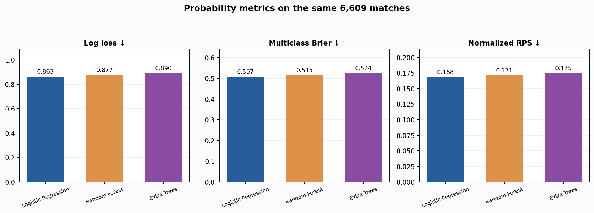
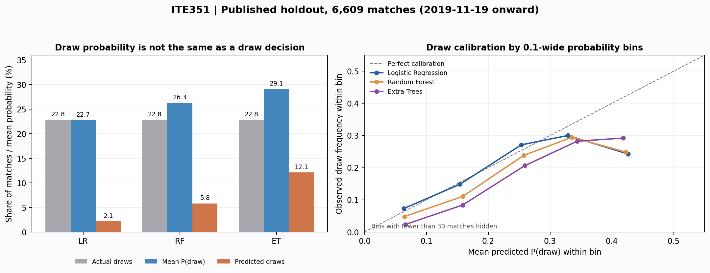

# Probability and draw evaluation supplement

This supplement re-runs the existing models in [`src/train.py`](../../src/train.py) on the same Kaggle `results.csv` and chronological split. It adds per-match class probabilities and probability scores without replacing the published model results. The 6,609 evaluation matches run from 2019-11-19 through 2026-10-06. The script checks the input SHA-256, split sizes, accuracy, macro-F1, and full confusion matrices against the published artifacts before writing any results.

## Measured results

All three probability scores are lower-is-better. Values below come from the attached `probability_metrics.json`, not hypothetical forecasts.

| Model | Accuracy | Macro-F1 | Draw recall | Log loss | Brier | RPS |
|---|---:|---:|---:|---:|---:|---:|
| Majority class | 0.477 | 0.215 | 0.000 | 18.843 | 1.046 | 0.409 |
| Logistic Regression | **0.608** | 0.465 | 0.034 | **0.863** | **0.507** | **0.168** |
| Random Forest | 0.599 | 0.480 | 0.075 | 0.877 | 0.515 | 0.171 |
| Extra Trees | 0.592 | **0.509** | **0.161** | 0.890 | 0.524 | 0.175 |



The Brier score is the match mean of the **sum** of the three class squared errors (range 0–2). Our normalized Ranked Probability Score (RPS) uses the outcome order **away win → draw → home win**, averages the two cumulative-probability squared errors (range 0–1), and then averages over matches. Reversing this order while keeping draw in the middle yields the same three-class RPS; putting draw at an endpoint changes its meaning. Some references omit the division by two, so formulas should be compared before comparing values. The majority classifier assigns zero probability to non-majority outcomes; its very high log loss is driven by probability clipping.

## Why few draws are predicted

Actual draws account for **22.8%** of the matches. Logistic Regression's **mean** draw probability is **22.7%**, but an argmax decision predicts a draw in only **2.1%** of matches, giving **3.4%** draw recall. A reasonable overall probability total does not imply a high draw decision rate. Extra Trees predicts draws in **12.1%** of matches and reaches **16.1%** draw recall, but its mean draw probability is **29.1%**, above the observed draw rate; the probability-bin plot also shows overprediction in several bins. The classifier with the highest macro-F1 therefore does not have the best probability scores.



`draw_calibration_bins.csv` uses fixed bins of width 0.1. The plot hides bins with fewer than 30 matches and labels this choice. These bins are descriptive; no calibration mapping was fitted.

## Paired comparison and limits

We resampled **74 calendar-month blocks** with replacement **5,000** times, keeping the two models paired on the same matches. For Extra Trees minus Logistic Regression, the macro-F1 difference was **+0.0439**, with an exploratory 95% percentile interval **[+0.0332, +0.0551]**. The accuracy difference was **−0.0162**, interval **[−0.0239, −0.0079]**. The machine-readable calculations are in `paired_block_bootstrap.json`.

These intervals describe uncertainty for an **already inspected holdout** and are not a confirmatory significance test. Calendar months are not fully independent, and the models use different class-weight settings. Consequently, this comparison does not isolate algorithm effects. The published test results have already been viewed by the team; this period must not be described as a newly blind test. No model, threshold, or probability calibration was selected or fitted using these holdout outcomes in this supplement.

The benchmark is **sequential pre-match prediction**. For each date, all matches receive features before that date's outcomes update historical form and Elo. A result from an earlier test date can therefore inform features for a later test date; model weights stay fixed. This represents a use case where previous match results are known before the next match. It is not a single forecast of the entire test period with all features frozen at its start.

## Reproduce

From the repository root, install the model dependencies in `src/model_requirements.txt`; plotting also requires Matplotlib. Then run:

```sh
python results/probability/probability_eval.py --repo . --output results/probability
python results/probability/probability_plot.py --input results/probability
```

The files serve different purposes:

- `holdout_predictions.csv`: each match's actual class, predicted class, and three probabilities for all four models.
- `probability_metrics.json`: probability and classification metrics.
- `draw_calibration_bins.csv`: fixed draw-probability bin counts and observed rates.
- `paired_block_bootstrap.json`: paired month-block interval details.
- `probability_run_metadata.json`: data hash, versions, and scoring definitions.
- PNG and SVG figures: editable/scalable visual references for the report or presentation.

For a future decision rule that favors draws, choose thresholds and class weights using **earlier time-validation windows**, then assess the chosen rule on genuinely new data. The separate exploratory time-validation work is not included here.
