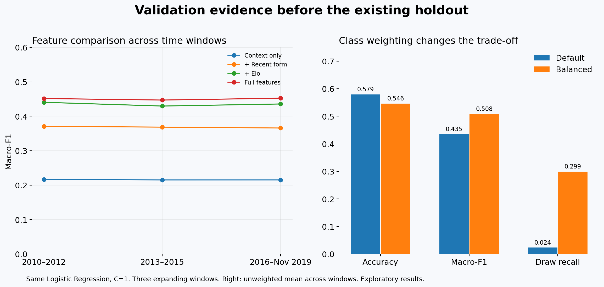

# Feature ablation and chronological validation

This supplement tests whether the project's pre-match features help beyond match context alone. It is a separate, reproducible experiment that **does not alter** the published 2019-11-19 onward holdout metrics.

## Question

Do recent form and Elo add useful predictive signal when the classifier and time-validation protocol are held fixed?

## Protocol

We build all features from `data/results.csv` with the same `build_features` implementation as [`src/train.py`](../../src/train.py). Prediction rows begin in 1990; earlier rows initialize team histories only. For every match date, all same-date features are created before any result from that date updates team histories.

The experiment uses expanding chronological windows. Each fold fits imputation, scaling, categorical encoding, and model parameters on its training period only. During a validation period, earlier completed matches may update form and Elo for later dates, while model weights stay fixed. The 2019-11-19 onward holdout is excluded from feature construction, fitting, and evaluation here.

| Training period | Validation period | Training rows | Validation rows |
|---|---|---:|---:|
| 1990-01-01 to 2010-01-01 | 2010-01-01 to 2013-01-01 | 16,482 | 3,007 |
| 1990-01-01 to 2013-01-01 | 2013-01-01 to 2016-01-01 | 19,489 | 2,858 |
| 1990-01-01 to 2016-01-01 | 2016-01-01 to 2019-11-19 | 22,347 | 3,865 |

## Feature ablation results

The rows below are equal-weight means across the three validation periods. The first three rows keep the same Logistic Regression setup (`C=1`, default class weights) and successively add features. This is why they can support a claim about feature contribution.

| Features | Accuracy | Balanced accuracy | Macro-F1 | Draw recall |
|---|---:|---:|---:|---:|
| Context only: neutral venue + Friendly/Other | 0.479 | 0.333 | 0.216 | 0.0% |
| Context + recent 5/10-match form + rest | 0.524 | 0.418 | 0.368 | 0.6% |
| Context + form + rest + pre-match Elo | 0.579 | 0.482 | 0.435 | 2.4% |
| Full existing feature set | 0.582 | 0.491 | 0.450 | 4.3% |



Recent form raises mean macro-F1 from 0.216 to 0.368, and adding Elo raises it further to 0.435. The full set also adds historical aggregates, directional head-to-head information, and the original tournament encoding, so its small additional gain must not be attributed to one feature alone.

## Draw trade-off

On the same context + form + Elo features, changing the Logistic Regression class weight to `balanced` raises mean draw recall from 2.4% to about 30.0% and macro-F1 from 0.435 to about 0.508. Accuracy decreases from 0.579 to about 0.546. This is a trade-off, not a universal improvement.

The small `C` check (`0.1`, `1`, `10`) used only these earlier validation periods. Macro-F1 differs by less than 0.001, so this experiment does not claim a tuned optimum or select a final model.

## Scope and limitations

These are historical validation windows, not a newly untouched blind test: the team had already examined broad EDA covering this era. They still avoid refitting against the published final holdout. The results are descriptive means over three windows, not confidence intervals or formal statistical-significance claims.

The source-data audit found 49,945 rows, no missing values in required columns, no exact duplicate rows, and one repeated `date + home_team + away_team` key with conflicting scores: Tahiti vs New Caledonia on 1974-02-17. It is preserved in the data and recorded in `fixture_key_review.csv`; it should be checked against the source before making any deletion claim.

## Reproduce

Install the tested model dependencies in `src/model_requirements.txt`, then run from the repository root:

```sh
python results/validation/defence_experiments.py --repo . --output results/validation
```

The script writes the per-fold measurements, summary, data audit metadata, and the fixture-key review. It does not write into the existing `results/` files outside this folder.
